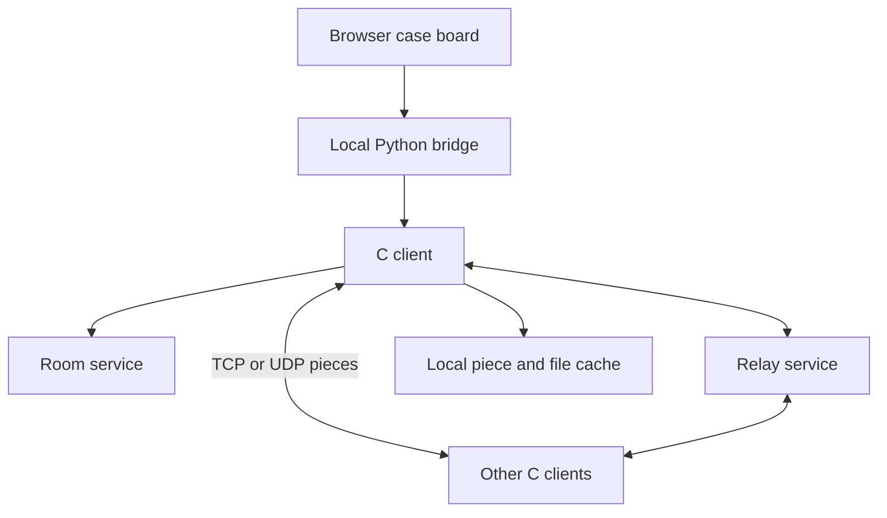

<div align="center">

# Fragment Archive

**Share the evidence. Piece together the truth.**

A cooperative mystery built on C sockets, with peer-to-peer file exchange, recovery, and multiple transport paths exposed through a browser case board.

[简体中文](README.md) · **English**

[](LICENSE)


[Quick start](#quick-start) · [Multiplayer](#multiplayer) · [Architecture](#architecture) · [Tech stack](#tech-stack) · [Workflow](#workflow) · [Testing](#testing)

</div>

## About

One case, multiple peers. The host generates a case and its evidence. Players request missing pieces, verify the results, inspect the evidence, and advance through questions and an accusation. A player who holds the files can serve other players: subsequent downloads need not depend on the original host as long as a reachable peer still holds the required content.

Fragment Archive combines a cooperative mystery with distributed file exchange. The browser provides the case board, Python connects the interface to local processes, and the C core manages room communication, piece transfer, and recovery. Players can both receive evidence and serve it to other peers.

## Features

| Capability | Implementation |
| --- | --- |
| Cooperative mystery | Case generation, evidence collection, chapter questions, and accusation flow |
| Peer exchange | 16 KiB logical pieces, availability bitfields and HAVE announcements, multiple sources |
| Integrity | SHA-256 checks for pieces and complete files before completion is accepted |
| Recovery | Reuse of valid cached pieces after restart, damaged-piece replacement, retries and source switching |
| Transport paths | Direct TCP, UDP probing and hole punching, relay, and manual mode selection |
| UDP recovery | Subpacket fragmentation, missing-subpacket recovery, bounded retries, and relay fallback |
| Observability | Member and source labels, path status, network logs, and transfer statistics |
| Optional AI generation | Ark image and language model integration, with local templates available without an API key |

> IPv4 networking is supported. UDP hole punching depends on NAT behavior, firewalls, and network topology; relay transport is available when a direct path cannot be established.

## Tech stack

| Layer | Technology | Purpose |
| --- | --- | --- |
| Network core | C, POSIX sockets, `select`, pthread | Concurrent connections, network events, and thread coordination |
| Transport | Custom application protocol, TCP, UDP | Room control, piece exchange, probing, and relay |
| Integrity | OpenSSL / libcrypto, SHA-256 | Piece and complete-file verification |
| Local service | Python 3, standard-library HTTP server | Static assets, action endpoints, and C process bridge |
| Web interface | HTML, CSS, JavaScript | Case board, evidence viewer, and network status |
| Case generation | Python, Pillow | Local image and text evidence generation |
| Optional cloud generation | Ark image and language model APIs | Image rendering and story generation |
| Build and testing | Make, C test programs, Python test scripts | Compilation, protocol tests, and fault regression |

## Quick start

### 1. Install prerequisites

| Platform | Setup |
| --- | --- |
| Linux | Primary POSIX development environment with GCC, Make, and Python 3 |
| Windows | WSL2 + Ubuntu; build and run services inside WSL |
| macOS | Xcode Command Line Tools and Homebrew OpenSSL |

Ubuntu / WSL:

```bash
sudo apt update
sudo apt install -y git build-essential python3 python3-venv libssl-dev
```

macOS, with Homebrew installed:

```bash
xcode-select --install
brew install python openssl@3
```

Skip the first command if Xcode Command Line Tools are already installed.

### 2. Clone and build

Use **Code → Clone** or **Download ZIP** on the repository page to obtain the source. From the cloned or extracted repository root, run:

```bash
python3 -m venv .venv
source .venv/bin/activate
python3 -m pip install Pillow

make transfer
```

`make transfer` builds `room_server`, `relay_server`, and `client_transfer`. The web server uses Python's standard library, but case image generation requires Pillow, including the local template workflow.

### 3. Start the web interface

```bash
python3 ui_prototype/server.py
```

Open **[http://localhost:8080/ui_prototype/index.html](http://localhost:8080/ui_prototype/index.html)** and keep the terminal running.

1. Enter a nickname in the host panel and select “现场生成新案” (generate a new case).
2. Without an API key, choose “仍要生成” (generate anyway) to use local templates.
3. Select the generated case and enter the room.
4. Other players follow the multiplayer steps below, download evidence, and continue the mystery.

When creating a client, the web bridge checks for local room and relay services and starts them when needed. Do not start duplicate services if they are already running. Loading the page alone does not establish room membership or a completed network transfer.

To use another HTTP port:

```bash
PORT=8081 python3 ui_prototype/server.py
```

## Workflow

| Step | Action | Result |
| --- | --- | --- |
| 1. Create a case | Generate a new case or select an existing one | Evidence files and an integrity manifest are available |
| 2. Open a room | The host connects to the Tracker; detectives join | Peer information and the case manifest are synchronized |
| 3. Obtain evidence | Select the download action | Missing pieces are requested from online holders |
| 4. Verify and inspect | Wait for completion, then open the evidence | Verified content appears on the case board |
| 5. Advance the story | Complete chapter questions and the accusation | Progress through the case to its conclusion |
| 6. Leave or reconnect | Exit the room and rejoin when needed | Valid local cache remains available for reuse |

Each player runs a local client; the browser does not perform peer transport itself. Verified downloaded pieces can be served to other players by the client.

## Multiplayer

### Deployment

Each player builds and starts the web interface on their own computer and opens their own `localhost:8080`. All players enter the **same Tracker address**. The Tracker machine can be separate from the case host. In that arrangement, enter the Tracker address even if the UI field is labeled as the host machine.

On the service machine, run these commands in separate terminals:

```bash
# Terminal A: room service
./room_server
```

```bash
# Terminal B: relay service
./relay_server
```

The room service and production relay should run on the same machine. The current implementation shares membership information through `/tmp/room_peers.txt`.

### Join a session

1. Start both services and share the service machine's reachable IPv4 address.
2. The host generates or selects a case and joins first.
3. Other players select “我是侦探” (detective), use distinct nicknames, and enter the same Tracker address.
4. For reproducible testing, participants select the agreed transport mode.
5. Start with missing evidence, select “下载证物” (download evidence), and inspect completion and source labels.

Nicknames are limited to 1–16 UTF-8 **bytes**, not 16 Unicode characters. A room currently supports up to four clients.

| Mode | What to verify |
| --- | --- |
| Direct TCP | Piece transfer and integrity on a reachable LAN |
| UDP hole punching | Probing, peer connectivity, and subpacket transfer; inspect fallback records on failure |
| Relay | Messages and file data exchanged through `relay_server` |
| Automatic | Default path selection; inspect logs and statistics for the actual path |

### Ports

| Port | Protocol | Purpose |
| --- | --- | --- |
| 8080 | TCP / HTTP | Local web interface and command bridge; configurable through `PORT` |
| 37401 | TCP | Room admission, heartbeats, peer lists, and manifests |
| 37402 | UDP | Reflected-address probing |
| 37405 | TCP | Relay service |
| 37404 | UDP | LAN broadcast announcements |
| Dynamic | TCP / UDP | Client listeners and peer UDP transfers |

Allow the corresponding traffic through firewalls. WSL networking, hotspot client isolation, and NAT behavior can affect direct connections. Allowing only the Tracker port does not guarantee peer reachability.

## Architecture



- **Control plane:** the Tracker handles admission, peer lists, heartbeats, address probing, and manifest distribution.
- **Data plane:** clients exchange pieces directly or through the relay. The relay carries content, not just registration messages.
- **Interaction:** Python translates browser actions into C client commands and reads state snapshots to update the page.
- **Generation:** the host produces two image evidence files and one text file, with a manifest and integrity hashes.

After the original host leaves, online peers holding the required pieces can continue serving downloads. If the only holder goes offline, the client must wait for a source to return. Relay transport requires an available relay service.

## Testing

### Automated regression

Stop existing clients, room services, and relays to avoid port conflicts. From the repository root, run:

```bash
make test-transfer
```

The target builds its dependencies and starts its own test processes. A successful full run should include:

```text
ALL STREAM TESTS PASS
ALL TRANSFER INTEGRATION TESTS PASS
```

| Area | Checks |
| --- | --- |
| TCP framing | Incremental parsing of split and coalesced messages |
| Peer exchange | File integrity, multiple sources, source departure, and Tracker loss |
| Cache recovery | Restart resume, damaged cached pieces, and same-nickname rejoin |
| UDP fault injection | Selective loss recovery and relay fallback under total data loss |
| Relay | Piece forwarding, room and source validation, and slow-reader isolation |
| Manifest validation | Truncation, trailing data, and invalid file metadata |

Use actual output from the current commit to assess results. Test cases and fault injection logic are available in `tests/test_transfer_stream.c`, `tests/test_transfer.py`, and `tests/udp_fault.c`.

### Multi-machine example: exchange after the original host leaves

1. A creates a case. B downloads all files and stays online.
2. A leaves; the Tracker and relay remain running.
3. C joins with a cache that does not contain the case and confirms all three files are missing.
4. C downloads from B and checks sources, piece counts, and integrity.
5. Save C's completion screenshot, client statistics, and server logs from the matching time interval.

Repeat separately for UDP and relay mode. Selecting relay manually is different from testing automatic fallback after UDP failure. Cached files do not demonstrate a new network download.

### Logs and interpretation

Web network logs and state snapshots are stored at `logs/netlog_<id>.log` and `logs/ui_state_<id>.json`. Back up the entire `logs/` directory after leaving and before clearing runtime data.

- `FILE_COMPLETE`: file completion; check alongside complete piece counts and integrity results.
- `TRANSFER_STATS`: `tcp_up`, `udp_up`, and `relay_up` are local upload counters; `from_<peer>` tracks incoming bytes by source.
- `RELAY_BOUND` / `RELAY_FORWARD`: relay binding and forwarding records; a single record is not proof of whole-file completion.
- State JSON is a snapshot, not a complete timeline. Record mode, commit, timestamps, and peer identities when comparing machines.

## Optional AI case generation

Configure the Ark API key and optional model endpoints in the web settings. Configuration is stored locally in `src/ai_gen/.env`. Without a key, the generator uses local drawings and story templates.

Cloud generation requires access to the relevant service and may incur charges. P2P transfer does not depend on a cloud model. The implementation is under `src/ai_gen/`. Keep credentials in local configuration only.

## Repository layout

| Path | Responsibility |
| --- | --- |
| `ui_prototype/` | Browser case board and Python command bridge |
| `src/common/` | Shared framing, configuration, and logging |
| `src/tracker/` | Room service |
| `src/relay/` | Relay service |
| `src/transfer/` | Piece scheduling, transfer, integrity, and recovery |
| `src/punch/` | UDP probing and hole punching |
| `src/ui/` | C client interaction and state |
| `src/generate/`, `src/ai_gen/` | Case generation and optional AI integration |
| `include/` | Shared protocol headers and constants |
| `tools/`, `tests/` | Utilities and reproducible tests |
| `assets/` | Case-generation assets |
| `docs/` | Protocol, design, build instructions, and experiment records |

## License

Distributed under the [MIT License](LICENSE). The repository's `LICENSE` file is authoritative for copyright and license terms.
