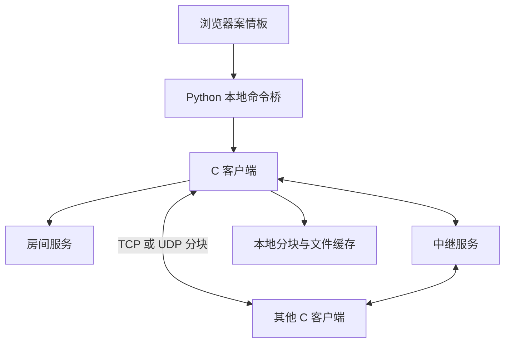

<div align="center">

# 碎片档案 · Fragment Archive

**交换证物，拼出真相。**

基于 C Socket 的 P2P 协作解谜项目，将分块传输、断点恢复与多路径通信呈现在浏览器案情板上。

**简体中文** · [English](README.en.md)

[](LICENSE)


[快速开始](#快速开始) · [多人联机](#多人联机) · [架构](#架构) · [技术栈](#技术栈) · [操作流程](#操作流程) · [测试](#测试)

</div>

## 项目介绍

一份案卷，多个节点。房主生成案件与证物，玩家通过网络取得缺失分块，完成校验后查看证物、回答问题并推进剧情。持有文件的玩家也能向其他玩家提供数据：只要仍有可达节点持有需要的内容，后续下载就不必始终依赖最初的房主。

Fragment Archive 将协作解谜与分布式文件交换结合：浏览器提供案情板，Python 连接界面与本地进程，C 核心处理房间通信、分块传输和故障恢复。玩家既是证物的接收者，也可以成为其他玩家的数据来源。

## 主要功能

| 能力 | 实现内容 |
| --- | --- |
| 协作解谜 | 案卷生成、证物收集、章节问答与指认流程 |
| 分块互传 | 16 KiB 逻辑分块，交换持有位图与 HAVE 通告，支持多来源请求 |
| 完整性检查 | 分块与整文件 SHA-256 校验，校验通过后才标记完成 |
| 恢复与容错 | 重启复用有效缓存、损坏块重新获取、来源掉线后重试或换源 |
| 多种传输路径 | TCP 直连、UDP 探测与打洞、中继；支持手动选择模式 |
| UDP 可靠性处理 | 子包拆分、缺失子包补传、有界重试与中继回落 |
| 可观察性 | 成员与来源显示、路径状态、网络日志和传输统计 |
| 可选 AI 生成 | 可接入方舟图像与语言模型；不配密钥也能使用本地模板生成 |

> 支持 IPv4 网络。UDP 打洞受 NAT 类型、防火墙和网络拓扑影响；无法建立直连时可使用中继路径。

## 技术栈

| 层级 | 技术 | 用途 |
| --- | --- | --- |
| 网络核心 | C、POSIX Socket、`select`、pthread | 多连接收发、网络事件处理与线程协作 |
| 传输协议 | 自定义应用层协议、TCP、UDP | 房间控制、分块交换、地址探测与中继 |
| 完整性校验 | OpenSSL / libcrypto、SHA-256 | 分块与整文件摘要验证 |
| 本地服务 | Python 3、标准库 HTTP 服务 | 静态资源、操作接口与 C 进程命令桥 |
| 网页界面 | HTML、CSS、JavaScript | 案情板、证物展示与网络状态 |
| 案卷生成 | Python、Pillow | 本地图片和文本证物生成 |
| 可选云端生成 | 方舟图像与语言模型 API | 图像渲染与剧情生成 |
| 构建与测试 | Make、C 测试程序、Python 测试脚本 | 编译、协议测试与故障回归 |

## 快速开始

### 1. 准备环境

| 平台 | 使用方式 |
| --- | --- |
| Linux | POSIX 主开发环境，使用 GCC、Make 和 Python 3 |
| Windows | 使用 WSL2 + Ubuntu，在 WSL 内编译并启动服务 |
| macOS | 使用 Xcode Command Line Tools 和 Homebrew OpenSSL |

Ubuntu / WSL：

```bash
sudo apt update
sudo apt install -y git build-essential python3 python3-venv libssl-dev
```

macOS（已安装 Homebrew）：

```bash
xcode-select --install
brew install python openssl@3
```

如果已安装 Xcode Command Line Tools，可跳过第一条命令。

### 2. 获取源码并构建

通过仓库页面的 **Code → Clone** 或 **Download ZIP** 获取源码。进入解压或克隆后的仓库根目录，执行：

```bash
python3 -m venv .venv
source .venv/bin/activate
python3 -m pip install Pillow

make transfer
```

`make transfer` 构建 `room_server`、`relay_server` 和 `client_transfer`。网页服务器本身使用 Python 标准库；案卷图像生成需要 Pillow，因此首次体验也应安装它。

### 3. 启动网页

```bash
python3 ui_prototype/server.py
```

打开 **[http://localhost:8080/ui_prototype/index.html](http://localhost:8080/ui_prototype/index.html)**，保持终端运行。

1. 在房主区域填写昵称，选择“现场生成新案”。
2. 未配置 API 密钥时，选择“仍要生成”，使用本地程序化模板。
3. 选择生成的案卷，进入房间。
4. 其他玩家按下方“多人联机”步骤加入，下载证物并继续解谜。

网页在创建客户端时会检查并按需启动本机房间服务和中继服务。若服务已手动启动，不要重复启动另一份。只打开网页不等于已经进房或完成网络传输。

如需更换网页端口：

```bash
PORT=8081 python3 ui_prototype/server.py
```

## 操作流程

| 步骤 | 操作 | 结果 |
| --- | --- | --- |
| 1. 创建案卷 | 房主生成新案，或选择已有案卷 | 创建证物文件与摘要清单 |
| 2. 建立房间 | 房主连接 Tracker，其他玩家以侦探身份加入 | 同步成员信息与案卷清单 |
| 3. 获取证物 | 点击“下载证物” | 从在线持有者请求缺失分块 |
| 4. 校验与查看 | 等待文件完成，点击“查看证物” | 校验后的内容呈现在案情板 |
| 5. 推进剧情 | 按页面提示完成章节问答与指认 | 推进案件直至结束 |
| 6. 退出或重连 | 离开房间，需要时重新加入 | 有效本地缓存可供后续使用 |

每位玩家在本机运行客户端；浏览器不直接承担对等网络传输。下载得到的有效分块可被客户端继续提供给其他玩家。

## 多人联机

### 部署方式

每位玩家在自己的电脑上构建并启动网页，使用自己的 `localhost:8080`。所有玩家填写**同一个 Tracker 地址**。Tracker 所在电脑可以与案卷房主不同；页面即使标注“房主主机”，独立部署时也应填写 Tracker 的地址。

服务机在两个终端分别运行：

```bash
# 终端 A：房间服务
./room_server
```

```bash
# 终端 B：中继服务
./relay_server
```

房间服务和正式中继应部署在同一台机器，当前实现通过 `/tmp/room_peers.txt` 共享成员信息。

### 联机顺序

1. 服务机启动上述两个服务，公布其可达 IPv4 地址。
2. 房主生成或选择案卷，先进入房间。
3. 其他玩家选择“我是侦探”，填写不同昵称与同一 Tracker 地址。
4. 为便于复现，所有参与者选择本轮约定的连接模式。
5. 玩家从“待下载”开始，点击“下载证物”，检查完成状态和来源。

昵称按 UTF-8 **字节数**限制为 1–16 字节；这不等于 16 个汉字。当前房间最多容纳 4 个客户端。

| 模式 | 适合验证 |
| --- | --- |
| TCP 直连 | 可达局域网中的分块收发与校验 |
| UDP 打洞 | UDP 探测、对端连通与子包传输；失败时检查回落记录 |
| 中继 | 客户端经 `relay_server` 交换消息与文件数据 |
| 自动 | 默认路径选择；实际承载路径以日志和统计为准 |

### 网络端口

| 端口 | 协议 | 用途 |
| --- | --- | --- |
| 8080 | TCP / HTTP | 本机网页与命令桥，可通过 `PORT` 调整 |
| 37401 | TCP | 房间加入、心跳、成员名单与清单 |
| 37402 | UDP | 反射地址探测 |
| 37405 | TCP | 正式中继 |
| 37404 | UDP | 局域网广播通告 |
| 动态端口 | TCP / UDP | 客户端之间的直连与 UDP 传输 |

防火墙需要允许对应流量。WSL 虚拟网络、热点客户端隔离与 NAT 类型都可能影响直连；仅放行 Tracker 端口不保证对等传输可达。

## 架构



- **控制面**：Tracker 处理加入、成员名单、心跳、地址探测与清单分发。
- **数据面**：客户端交换分块；无法直接通信时可经中继传输。中继会承载内容，并非只做登记。
- **交互层**：Python 将网页操作转换为 C 客户端命令，并读取状态文件更新页面。
- **生成层**：房主生成两份图像证物和一份文本证物，输出清单及校验摘要。

原房主退出后，下载可由仍在线且持有所需分块的节点提供。若唯一持有者离线，客户端需要等待来源恢复；中继路径依赖中继服务保持可用。

## 测试

### 自动化回归

先退出正在运行的客户端、房间服务和中继，避免端口冲突。在仓库根目录执行：

```bash
make test-transfer
```

测试会构建相关程序并自行启动测试子进程。完整通过时应出现：

```text
ALL STREAM TESTS PASS
ALL TRANSFER INTEGRATION TESTS PASS
```

| 测试范围 | 检查内容 |
| --- | --- |
| TCP 流解析 | 拆分和合并报文的增量解析 |
| 节点互传 | 文件校验、多来源、来源退出和 Tracker 离线场景 |
| 缓存恢复 | 重启续传、损坏缓存块拒绝、同昵称重新加入 |
| UDP 故障注入 | 选择性丢包补齐、全部数据丢失后的中继回落 |
| 中继 | 分块转发、房间与来源校验、慢接收方隔离 |
| 清单 | 截断、额外字节及非法文件元数据拒绝 |

测试结果以当前提交的运行输出为准。可直接查看 `tests/test_transfer_stream.c`、`tests/test_transfer.py` 和 `tests/udp_fault.c` 中的用例与故障注入逻辑。

### 多机测试：原房主离线后继续互传

1. A 创建案卷，B 下载完整文件并保持在线。
2. A 离开房间，Tracker 与中继保持运行。
3. C 使用未持有该案卷的缓存进房，确认三个文件待下载。
4. C 从 B 下载完成，核对文件来源、分块数与完整性。
5. 保存 C 的完成截图、客户端统计以及对应时段的服务端日志。

选择 UDP 和中继分别测试。主动选择中继与“UDP 失败后自动回落”是两项不同测试；已有本地文件也不能作为重新网络下载的证据。

### 日志与结果解释

网页网络日志和状态保存在 `logs/netlog_<id>.log` 与 `logs/ui_state_<id>.json`。离开房间后，在清理缓存前备份整个 `logs/`。

- `FILE_COMPLETE`：文件完成事件，结合完整块数和文件校验核对。
- `TRANSFER_STATS`：`tcp_up`、`udp_up`、`relay_up` 是本机上传量；`from_<peer>` 是按来源统计的下行量。
- `RELAY_BOUND` / `RELAY_FORWARD`：中继绑定与转发记录；单条记录不等于整文件完成。
- 状态 JSON 是快照，不是完整时间线；跨机器核对时保留测试模式、提交版本、时间和 peer 对照。

## 可选 AI 案卷生成

在网页“设置”中配置方舟 API 密钥及可选模型接入点，配置保存在本机 `src/ai_gen/.env`。未配置密钥时使用本地绘图与剧情模板。

云端生成需要相应服务访问权限，可能产生费用；P2P 传输本身不依赖云端模型。相关实现位于 `src/ai_gen/`。密钥只应保存在本机配置中。

## 项目结构

| 路径 | 职责 |
| --- | --- |
| `ui_prototype/` | 网页案情板与 Python 命令桥 |
| `src/common/` | 公共协议流处理、配置与日志 |
| `src/tracker/` | 房间服务 |
| `src/relay/` | 中继服务 |
| `src/transfer/` | 分块调度、传输、校验与恢复 |
| `src/punch/` | UDP 探测与打洞 |
| `src/ui/` | C 客户端交互与状态 |
| `src/generate/`、`src/ai_gen/` | 案卷生成与可选 AI 生成 |
| `include/` | 公共协议头与常量 |
| `tools/`、`tests/` | 工具与可复现测试 |
| `assets/` | 案卷生成素材 |
| `docs/` | 协议、设计、构建与实验记录 |

## 许可证

本项目采用 [MIT License](LICENSE)。版权归属及许可条款以仓库中的 `LICENSE` 原文为准。
